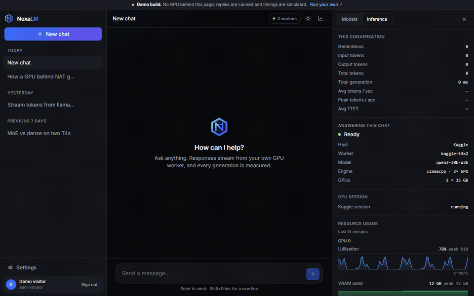
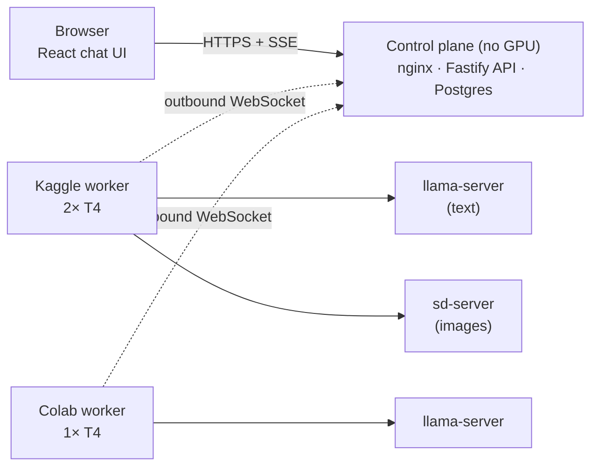
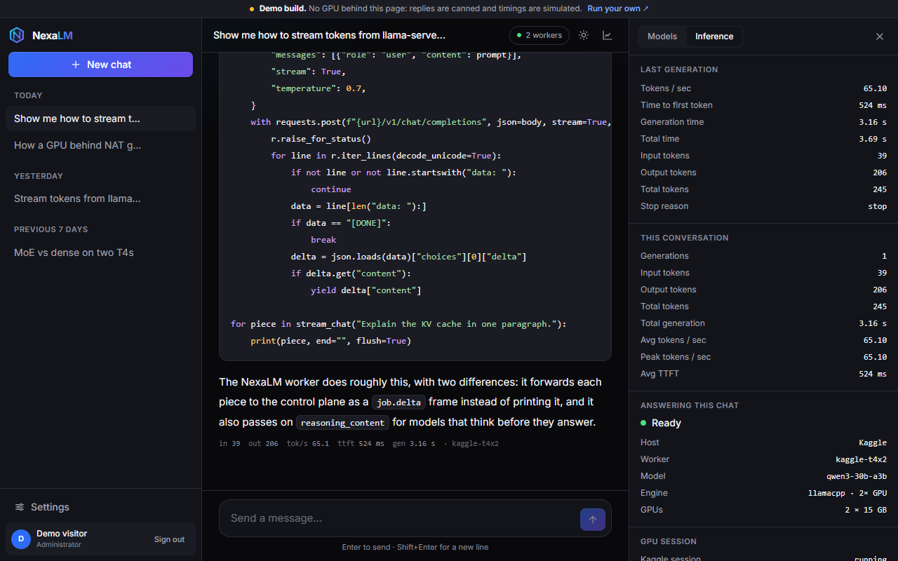
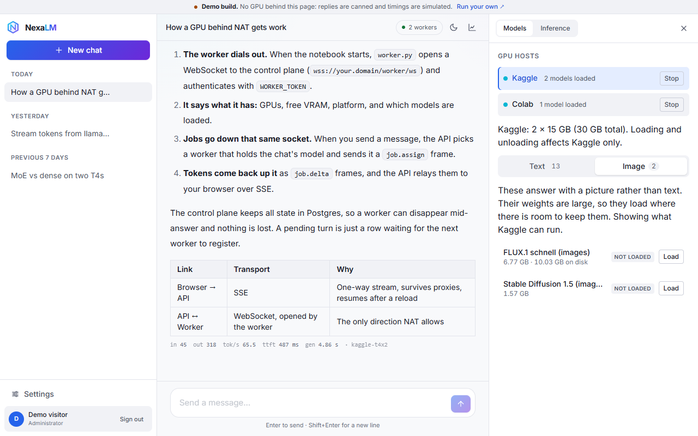

# NexaLM

Run open-weight LLMs and image models on free Kaggle and Colab GPUs, behind your own chat UI.



**Live demo: [nexalm.vercel.app](https://nexalm.vercel.app)**. It is the real UI with a fake backend in the browser. There's no GPU behind it, so the replies are canned and the timings are simulated.

## What it does

Free GPU notebooks are good hardware with awkward rules: they sit behind NAT, they shut down after a few hours, and you can't reach into them. NexaLM turns them into a chat platform anyway.

A small always-on server with no GPU holds the accounts, chats and queue. GPU workers on Kaggle (2× T4) and Colab (1× T4) dial out to it, say which models they can run, and take jobs. You get a multi-user chat app that streams tokens from a 30B model, generates images with FLUX, and keeps working when a notebook disappears mid-answer.

## How it works



| Step | What happens |
|---|---|
| 1 | A notebook starts `worker.py`, which opens a WebSocket **out** to the server. NAT allows that direction. |
| 2 | The worker registers its GPUs, free VRAM and loaded models. |
| 3 | You send a message. The API saves it in Postgres and picks a worker that holds the chat's model (or loads it, or queues the turn and says why). |
| 4 | The worker runs the model in `llama-server` or `sd-server` and streams tokens back up the socket. The API relays them to the browser over SSE. |
| 5 | If the worker vanishes, the turn is still a row in Postgres. The next worker to connect picks it up. |

## Features

- Multi-user chat: accounts, email verification, optional Google sign-in, per-user isolation of chats, jobs, metrics and images.
- Streaming text from GGUF models through llama.cpp, with the thinking trace shown separately for models that think.
- Image generation (FLUX.1 schnell, Stable Diffusion 1.5) through stable-diffusion.cpp, as its own engine.
- Several models loaded at once per GPU, with LRU eviction that never evicts a model mid-answer.
- Kaggle and Colab side by side, each with a model list sized to what that host can actually hold (VRAM and disk).
- Live metrics for every answer: time to first token, tokens per second, token counts, plus GPU telemetry.
- Start and stop Kaggle sessions from the UI. Colab has no API for that, and the UI says so.
- Optional web search (Apify, Brave, or Wikipedia with no key) with an SSRF guard.

| Chat with live metrics | Models per GPU host |
|---|---|
|  |  |

## Tech stack

| Part | Built with |
|---|---|
| Web UI | React 18, TypeScript, Vite, Tailwind CSS |
| API | Node.js, Fastify, TypeScript, PostgreSQL 16, WebSocket + SSE |
| Workers | Python, llama.cpp (`llama-server`), stable-diffusion.cpp (`sd-server`) |
| GPUs | Kaggle 2× Tesla T4, Google Colab 1× Tesla T4 |
| Deploy | Docker Compose, nginx, any TLS reverse proxy or tunnel |

Measured on the real thing: Qwen3-30B-A3B ran at 65.5 tok/s (478 ms to first token) on Kaggle's T4 pair, and 62.9 tok/s at a smaller quant on one Colab T4. It's a mixture-of-experts model, which is why it's fast here. Dense 70B runs, but in single digits.

## Run it

**Just the UI, no server** (the same build as the live demo):

```bash
git clone https://github.com/shakaibarsalan/nexalm
cd nexalm/web
npm install
npm run dev:demo        # http://localhost:5173
```

**The control plane** (a small Linux box with Docker):

```bash
git clone https://github.com/shakaibarsalan/nexalm /opt/local-llm
cd /opt/local-llm
cp .env.example .env            # replace every CHANGE_ME
mkdir -p artifacts images && sudo chown -R 1000:1000 artifacts images
docker compose up -d --build
curl -s localhost:8081/api/health
```

Put HTTPS in front of port 8081 (Caddy, nginx, a Cloudflare Tunnel) and sign up. The first account becomes the admin.

**A GPU worker on Colab:** upload `worker/colab/NexaLM_Colab_Worker.ipynb`, pick a T4 runtime, add `WORKER_TOKEN` under Colab's key icon, set `ORACLE_WS_URL` to `wss://your.domain/worker/ws` in the token cell, and run all cells.

**A GPU worker on Kaggle:** `./scripts/launch-kaggle-worker.sh` publishes the worker as a private Dataset. Then create a notebook with that Dataset, a **T4 ×2** accelerator and the two secrets. The [guide](docs/GUIDE.md#64-a-gpu-worker-on-kaggle) has the details.

**No GPU at all?** A mock worker tests the whole pipeline with canned text:

```bash
cd worker && pip install -r requirements.txt
ORACLE_WS_URL=ws://localhost:8081/worker/ws WORKER_TOKEN=... ENGINE=mock MODEL_ID=qwen3-0.6b python worker.py
```

**Tests:**

```bash
python3 scripts/test-worker.py                    # offline: no GPU, network or server
python3 scripts/e2e-test.py https://your.domain   # live, against a deployment
```

## Configuration

Copy `.env.example` to `.env`. The ones you must set:

| Variable | Example | What it's for |
|---|---|---|
| `DB_PASSWORD` | `CHANGE_ME` | Password for the bundled Postgres |
| `DATABASE_URL` | `postgres://localllm_user:CHANGE_ME@db:5432/localllm` | Same password as above |
| `COOKIE_SECRET` | 32+ random characters | Signs session cookies |
| `WORKER_TOKEN` | a long random string | Shared secret every GPU worker presents |
| `PUBLIC_ORIGIN` | `https://chat.example.com` | Your public URL, for cookies, OAuth and mail |

Optional: `SMTP_*` for verification mail, `GOOGLE_CLIENT_ID` / `GOOGLE_CLIENT_SECRET` for Google sign-in, `APIFY_TOKEN` or `BRAVE_API_KEY` for web search, `KAGGLE_API_TOKEN` to start Kaggle sessions from the UI. Workers need `ORACLE_WS_URL` and `WORKER_TOKEN`. Every variable is in the [configuration reference](docs/GUIDE.md#9-configuration-reference).

## Project structure

```
db/migrations/     SQL, applied when the API starts (the model catalogue lives here)
server/            Fastify API: auth, chats, job routing, worker WebSocket hub
web/               React UI; src/demo/ is the in-browser fake backend for the demo
worker/            Python GPU worker: engines/ (llama.cpp, sd.cpp), kaggle/, colab/
scripts/           Kaggle launcher, DB provisioning, offline and live test suites
docs/GUIDE.md      The long version: design decisions, protocol, API, every failure hit
docker-compose.yml Postgres + API + web
```

## Limitations

- No free GPU is always on. Kaggle gives about 30 hours a week, and Colab disconnects when idle. NexaLM queues turns until a worker connects, but someone has to start one.
- Kaggle's 2× T4 pair can't be requested through the API. You set it once in the notebook's settings.
- A free Google Drive is 15 GB, so Colab realistically caches one chat model. FLUX doesn't fit beside it.
- T4s are Turing: no bf16, no FlashAttention, no NVLink. Big dense models are slow, and image generation is fine at FLUX's 4 steps but slow at 20.
- Image progress is elapsed time, not a percentage. `sd-server` doesn't report steps.
- The CUDA build of `sd-server` is compiled on the first worker that needs it (around 26 minutes), then shared with later sessions.
- The demo site is UI only. It doesn't run any model.

## License

MIT. See [LICENSE](LICENSE). Models, llama.cpp and stable-diffusion.cpp have their own licences.

## Author

Shakaib Arsalan · [shakaib.vercel.app](https://shakaib.vercel.app) · [LinkedIn](https://www.linkedin.com/in/shakaib-arsalan)
