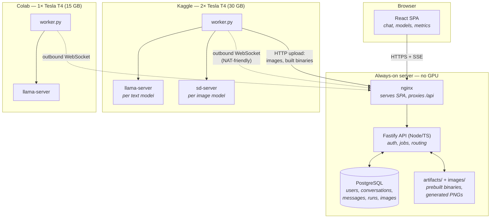
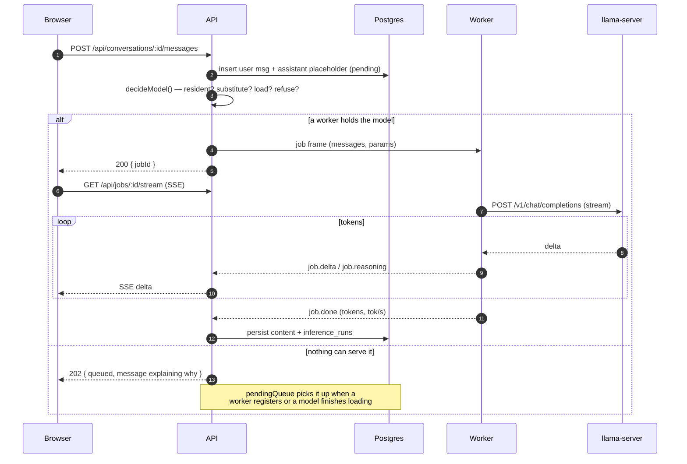
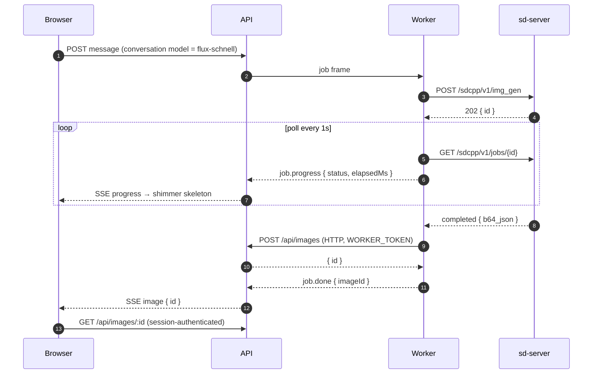
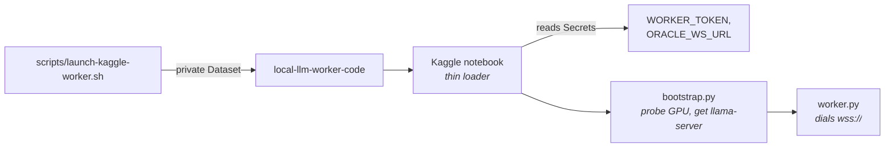
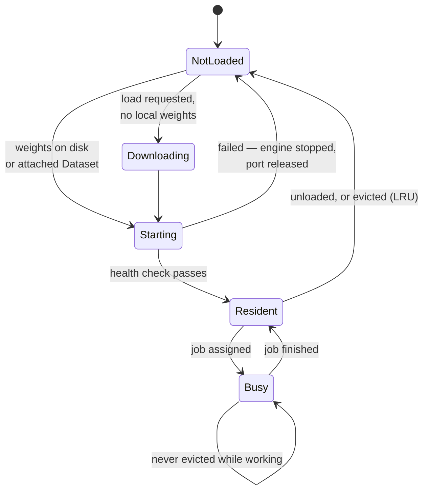

# NexaLM: the full guide

The [README](../README.md) is the short version. This is the long one.


A self-hosted chat platform that runs open-weight language models **and image
models** on free Kaggle and Google Colab GPUs, controlled from a small
always-on server that has no GPU of its own.

This document is written to be **replicated**. It states not only what the
system does but why each decision was made, and it ends with the failure modes
this project actually hit, with the symptom you will see and the fix. If you
hand this to a coding agent, it should be able to rebuild the system and debug
it without guessing.

---

## Table of contents

1. [What you get](#1-what-you-get)
2. [Architecture](#2-architecture)
3. [Why it is built this way](#3-why-it-is-built-this-way)
4. [How one request flows](#4-how-one-request-flows)
5. [Repository layout](#5-repository-layout)
6. [Replicating it](#6-replicating-it)
7. [Models and loading](#7-models-and-loading)
8. [Image generation](#8-image-generation)
9. [Configuration reference](#9-configuration-reference)
10. [Worker protocol](#10-worker-protocol)
11. [HTTP API](#11-http-api)
12. [Testing](#12-testing)
13. [Troubleshooting: every failure this project hit](#13-troubleshooting-every-failure-this-project-hit)
14. [Honest limits](#14-honest-limits)
15. [Security notes](#15-security-notes)

---

## 1. What you get

- A multi-user chat UI with accounts, email verification, and per-user
  isolation of conversations, jobs, metrics and generated images.
- **Text generation** on open-weight GGUF models via llama.cpp, streamed token
  by token, with live tokens/sec and time-to-first-token.
- **Image generation** via stable-diffusion.cpp, as a genuinely separate engine.
- **Several models resident at once**, loaded and unloaded on demand, with LRU
  eviction that never evicts a model mid-generation.
- **Two GPU hosts** — Kaggle and Colab — visible side by side, each with its own
  model list scoped to what that host can actually run.
- **Web search** through a provider chain, with an SSRF guard.
- A control plane that costs nothing to keep online and needs no GPU.

### The core constraint

Free GPU runtimes are **behind NAT**, **time-limited**, and **ephemeral**. You
cannot reach into them; they must reach out to you. Everything below follows
from that.

---

## 2. Architecture



### Two transports, on purpose

| Link | Transport | Why |
|---|---|---|
| Browser → API | **SSE** | One-way token stream. Survives proxies, auto-reconnects, no framing to write. The server replays deltas on reconnect, so a mid-answer reload resumes rather than stranding a half-written message. |
| API → Worker | **WebSocket, dialled outbound by the worker** | Kaggle and Colab are behind NAT and can never be reached inbound. The worker must initiate and hold the connection. |

### Why the server has no GPU

A GPU that is always on costs real money; the free tiers cost nothing but come
and go. Splitting the two means the **control plane holds all state** —
accounts, conversations, message history, metrics, images — and the GPU hosts
hold none. A worker can vanish mid-sentence and the conversation survives,
because the pending turn is a row in Postgres, not memory in a notebook.

---

## 3. Why it is built this way

These are the decisions that are expensive to reverse. Understand them before
changing anything.

**llama.cpp, not vLLM.** The free tiers are Turing (T4, sm_75): no bf16, no
FlashAttention, no NVLink between the two T4s. llama.cpp splits a model across
cards by layer, needs no fast interconnect, and ships an OpenAI-compatible
server to stream from. vLLM assumes hardware this tier does not have.

**A child process, not an in-process binding.** The worker talks to
`llama-server` / `sd-server` over localhost HTTP. A model crash then kills a
child process, not the worker and its connection to the control plane.

**The queue is a database query, not a memory structure.** A pending turn is
"an assistant message with no `inference_runs` row". It therefore survives an
API restart, a worker disappearing, and a redeploy.

**Nothing is evicted while it is working.** A model with an in-flight job is
never chosen for eviction. Everything else is LRU.

**The server is told what is true, not what was asked for.** Every model change
publishes the worker's resident set, so a load that failed half way cannot
leave the pool advertising a model it does not have.

**Availability is a property of a model *on a host*, never of a model alone.**
A flat list cannot answer "which host holds this, and where will a Load
happen". Everything in the Models panel is scoped to one host at a time.

---

## 4. How one request flows

### A text turn



### An image turn

The shape is different and that difference drove the design.



**Why images do not travel over the job socket.** A PNG is one to two megabytes
against an 8 MB frame ceiling, and every other frame on that link is small text.
The worker already speaks HTTP to the server for artifacts, so it uploads the
same way and the job frame carries only the id.

**Why upload and download authenticate differently.** Upload is a worker: it
has no account, and holds `WORKER_TOKEN`. Download is a browser, checked against
the conversation's owner. Serving images on the worker token would make every
user's pictures readable by anything holding one shared secret.

---

## 5. Repository layout

```
db/migrations/          Ordered SQL. Applied at API startup from MIGRATIONS_DIR.
server/
  src/
    routes/             HTTP surface: chat, conversations, workers, models,
                        auth, users, artifacts, images, settings
    services/           jobManager, workerRegistry, pendingQueue, webSearch,
                        mailer
    ws/workerHub.ts     The worker WebSocket endpoint
    middleware/auth.ts  Sessions, ownership predicates, route exemptions
    db/migrate.ts       Migration runner
  Dockerfile            NOTE: COPYs db/migrations INTO the image
web/
  src/components/       ModelsPanel, MessageList, SettingsModal, MetricsPanel …
  src/hooks/            useChatStream (SSE consumer)
  nginx.conf            SPA + /api proxy + per-endpoint body limits
worker/
  worker.py             The agent that dials out and serves jobs
  models.py             ModelManager: residency, eviction, engine dispatch
  engines/
    base.py             InferenceEngine interface
    llamacpp.py         Text generation
    stablediffusion.py  Image generation
    gpu.py              nvidia-smi probing, tensor-split
    model_catalog.py    Live Hugging Face lookups (never a hardcoded table)
  provision/common.py   Shared bootstrap: GPU probe, arch, placement, context
  kaggle/bootstrap.py   Kaggle session bootstrap
  colab/                colab_worker.py + generated notebook
scripts/
  test-worker.py        76 offline checks — no GPU, no network, no server
  e2e-test.py           69 live checks against a real deployment
  launch-kaggle-worker.sh
  kaggle-cli.sh
```

---

## 6. Replicating it

### 6.1 Prerequisites

| Thing | Why | Notes |
|---|---|---|
| A small always-on server | Control plane | 1–2 vCPU, 4 GB RAM, ~20 GB disk. An Oracle Cloud free Ampere A1 works. **Check `uname -m`** — see §13. |
| A domain with TLS | Workers dial `wss://` | Any reverse proxy with a certificate. |
| Docker + Docker Compose | Everything ships as containers | |
| PostgreSQL 16 | State | Can be a container or an existing instance with its own DB and role. |
| A Kaggle account | GPU | Phone-verified, for GPU access. ~30 h/week. |
| A Google account | GPU | For Colab. |
| An SMTP account | Verification email | A Gmail app password is fine. |

### 6.2 Bring up the control plane

```bash
git clone https://github.com/shakaibarsalan/nexalm /opt/local-llm && cd /opt/local-llm
cp .env.example .env      # then fill it in — see §9
```

`docker-compose.yml` starts its own Postgres (`db`). Set `DB_PASSWORD` and use
the same password inside `DATABASE_URL`. To use a Postgres you already run,
delete the `db` service and create the role and database with
`scripts/provision-db.sh`. Then:

```bash
mkdir -p artifacts images

# The API image drops to its unprivileged `node` user, uid 1000. If your host
# account is not uid 1000, every write fails with EACCES — and for images that
# surfaces only when the first picture is generated, a long way from the cause.
sudo chown -R 1000:1000 artifacts images
sudo chmod 775 artifacts images

docker compose build
docker compose up -d
curl -s localhost:8081/api/health
```

> **Migrations live inside the API image** (`server/Dockerfile` COPYs
> `db/migrations`). A new migration therefore needs
> `docker compose build api`, **not** just `up -d --force-recreate`. This
> mistake was made twice on this project; see §13.

### 6.3 First account

Sign up through the UI. The very first account becomes the admin
automatically. To promote someone later, use the Users panel in Settings, or:

```sql
UPDATE users SET role = 'admin' WHERE email = 'you@example.com';
```

Admin gates model loading/unloading, worker start/stop, and user management.

### 6.4 A GPU worker on Kaggle

Kaggle is the better host: two T4s (30 GB total) and roomy Dataset storage.



1. **Publish the worker code** as a private Dataset:
   ```bash
   ./scripts/launch-kaggle-worker.sh
   ```
   This updates **only the Dataset**, deliberately. `kaggle kernels push` resets
   the notebook's accelerator to the default (P100 instead of T4 ×2) **and drops
   its Secrets**. Pass `--push-kernel` only when the thin loader itself changed.

2. **In the Kaggle UI**, create a notebook that attaches that Dataset, sets the
   accelerator to **T4 ×2**, and adds Secrets `WORKER_TOKEN` and
   `ORACLE_WS_URL`. Kaggle's 2×T4 pair **cannot be requested through the API** —
   only inherited from the notebook's saved configuration, so this is a one-time
   manual step.

3. **Run it.** The worker connects in well under a minute, because it no longer
   preloads a model (§7).

### 6.5 A GPU worker on Colab

```bash
python worker/colab/build_notebook.py   # regenerate after any worker change
```

Open `worker/colab/NexaLM_Colab_Worker.ipynb` in Colab, set the runtime to a
T4 GPU, put `WORKER_TOKEN` and `ORACLE_WS_URL` in the Secrets panel, and run.

Colab mounts Drive and keeps weights there, so a later session does not
re-download them. **Google provides no API to start Colab**, so this host is
always started by hand; the UI says so rather than showing a Start button that
cannot work.

### 6.6 Verify

```bash
python3 scripts/test-worker.py                          # 76 offline checks
python3 scripts/e2e-test.py https://your.domain          # 69 live checks
```

---

## 7. Models and loading

### The catalogue

Models are **rows in Postgres**, not a hardcoded list. Each row carries `id`,
`repo`, `engine`, `kind`, `quantization`, `context_length`, `approx_size_gb`,
`disk_gb`, `min_vram_gb`, `supports_vision`, `enabled`.

Sizes are read **live from the Hugging Face API** rather than a table in code.
A hardcoded table drifted once already when a repository was requantised.

### Residency



`ModelManager` keeps several models resident, each behind its own server on its
own port, and evicts the least-recently-used **idle** model when it needs room.

### No preloading

Workers start with **nothing resident**. Preloading used to be unconditional and
cost every session minutes before it could do anything — then cost them again,
because the model it loaded was whatever the notebook defaulted to. Asking for a
picture meant loading an 18.6 GB language model first and immediately evicting
it. Set `PRELOAD_MODEL=1` for the old behaviour.

The first chat turn on a fresh worker therefore returns **202** with an
explanation, and the queue answers it once the model is up.

### What fits

| Model | Q4_K_M | Kaggle 2×T4 (29.5 GB) | Colab 1×T4 (12.5 GB) |
|---|---:|---|---|
| Gemma 3 4B · *vision* | 2.5 GB | ✅ | ✅ |
| Qwen3 8B | 5.0 GB | ✅ | ✅ |
| Gemma 3 12B · *vision* | 7.3 GB | ✅ | ✅ |
| Phi-4 14B | 8.9 GB | ✅ | ✅ |
| GPT-OSS 20B · *MoE* | 11.6 GB | ✅ | ✅ |
| Mistral Small 24B | 14.3 GB | ✅ | ✗ |
| Gemma 3 27B · *vision* | 16.5 GB | ✅ | ✗ |
| Qwen3 30B-A3B · *MoE* | 18.6 GB | ✅ | Q2 only |
| Llama 3.3 70B | 24.3 GB *(IQ2)* | ✅ *slow* | ✗ |

**Mixture-of-experts is the win on this hardware.** Qwen3-30B-A3B has 30B
parameters but only ~3.3B active per token — **65 tok/s** on a T4 pair. Llama
3.3 70B is dense: every token reads all 24 GB, so expect single digits.

### Measured performance

| | Kaggle 2×T4 | Colab 1×T4 |
|---|---|---|
| Model | Qwen3-30B-A3B Q4_K_M | Qwen3-30B-A3B UD-Q2_K_XL |
| Throughput | **65.5 tok/s** | **62.9 tok/s** |
| Time to first token | 478 ms | 681 ms |

---

## 8. Image generation

llama.cpp cannot generate images, so this is a second engine, selected by the
catalogue's `engine` column.

| Model | On disk | VRAM | Steps | Kaggle | Colab |
|---|---:|---:|---:|---|---|
| FLUX.1 schnell | 10.0 GB | ~7 GB | 4 | ✅ | ✗ *storage* |
| Stable Diffusion 1.5 | 1.6 GB | ~4 GB | 20 | ✅ | ✅ |

**Colab refuses FLUX on storage, not VRAM.** It needs ~7 GB on the card, which a
single T4 holds comfortably — but 10 GB of files, against a 15 GB free Drive
that already holds a chat model. Sizing by VRAM alone would offer it and then
fail halfway through a download, so the catalogue records `disk_gb` as well.

**FLUX is four files, from one ungated repository.**

| Role | File | Size |
|---|---|---:|
| diffusion | `flux1-schnell-Q4_0.gguf` | 6.69 GB |
| text encoder | `t5xxl-Q4_K.gguf` | 2.75 GB |
| text encoder | `clip_l.safetensors` | 0.25 GB |
| VAE | `ae.safetensors` | 0.34 GB |

All from `second-state/FLUX.1-schnell-GGUF`. The obvious sources split across
three repositories, and the VAE's (`black-forest-labs/FLUX.1-schnell`) is
`gated: auto` — an anonymous worker fails there **after** downloading 6.7 GB.
Taking T5 quantised is the difference between 10 GB and 17 GB.

**Device placement.** With two cards, the text encoders go on the second one:

```
--backend te=cuda1,diffusion=cuda0,vae=cuda0
```

With one card they fall back to `--clip-on-cpu`, because 3.2 GB of T5 and CLIP
will not fit beside the diffusion model.

Deliberately **not** a split of one model across devices. Upstream says
row-splitting a module is *"usually the faster option when the devices have fast
interconnect"* — a pair of T4s is PCIe with no NVLink. Layer-splitting is worse
for latency still, since it runs blocks sequentially: it buys capacity, not
speed. `SD_BACKEND` overrides the placement so alternatives can be measured.

**Progress is coarse, honestly.** `sd-server` reports a status and a queue
position and nothing else — no step counter — so the UI shows elapsed time and a
shimmer rather than a bar whose position would be invented.

**The binary must be built on a worker.** Upstream publishes Linux binaries for
CPU, ROCm and Vulkan but **not CUDA**. The first worker to need it compiles it
(~26 min) and then publishes the tarball to `/api/artifacts`, so every later
session downloads ~65 MB instead.

---

## 9. Configuration reference

### Server (`.env`)

| Variable | Required | Purpose |
|---|---|---|
| `DATABASE_URL` | ✅ | Postgres connection string |
| `DB_PASSWORD` | ✅ with the bundled `db` | Password for the Postgres container; must match `DATABASE_URL` |
| `WORKER_TOKEN` | ✅ | Shared secret for workers: WS auth, artifact and image upload |
| `COOKIE_SECRET` | ✅ | Signs session cookies (32+ characters) |
| `PUBLIC_ORIGIN` | ✅ | e.g. `https://chat.example.com` — used in OAuth and mail |
| `DEFAULT_MODEL` | | Catalogue id used when a conversation names none |
| `SMTP_HOST` / `SMTP_PORT` / `SMTP_USER` / `SMTP_PASS` / `SMTP_FROM` | | Verification and welcome mail |
| `OTP_EXEMPT_DOMAINS` | | Domains that skip email verification |
| `GOOGLE_CLIENT_ID` / `GOOGLE_CLIENT_SECRET` / `GOOGLE_REDIRECT_URI` | | Google sign-in |
| `APIFY_TOKEN` | | Web search (preferred provider) |
| `BRAVE_API_KEY` | | Web search (fallback) |
| `KAGGLE_API_TOKEN` | | Lets the UI start/stop a Kaggle session |
| `KAGGLE_KERNEL_SLUG` / `KAGGLE_KERNEL_TITLE` / `KAGGLE_MACHINE_SHAPE` / `KAGGLE_DATASET_SOURCES` | | Kaggle session parameters |
| `APP_ACCESS_TOKEN` | | Optional extra gate in front of the login screen |
| `ARTIFACTS_DIR` / `IMAGES_DIR` | | Defaults `/app/artifacts`, `/app/images` |
| `MIGRATIONS_DIR` | | Default `/app/db/migrations` |
| `LOG_LEVEL` / `NODE_ENV` | | |

### Worker

| Variable | Default | Purpose |
|---|---|---|
| `ORACLE_WS_URL` | *required* | `wss://your.domain/worker/ws` |
| `WORKER_TOKEN` | *required* | Must match the server |
| `WORKER_NAME` / `WORKER_ID` | derived | Label and stable id across reconnects |
| `WORKER_PLATFORM` | inferred | `kaggle` \| `colab` \| `other`. **Stated, not inferred** — filesystem probing once mislabelled a Colab worker as Kaggle |
| `PRELOAD_MODEL` | `1` (worker) / `0` (bootstraps) | Load a model at startup |
| `MODEL_CACHE_DIR` | platform default | Where weights persist. On Colab, point at Drive |
| `WORKER_SCRATCH_DIR` | platform default | Where binaries are built — keep off a FUSE mount |
| `MODEL_ID` / `MODEL_PATH` | | Only used when preloading |
| `CONTEXT_LENGTH` | `16384` | |
| `N_GPU_LAYERS` | `999` | |
| `IDLE_SHUTDOWN_MINUTES` | `30` | Protects a metered quota |
| `LLAMA_SERVER_BIN` / `SD_SERVER_BIN` | on `PATH` | Explicit binary paths |
| `SD_BACKEND` | | Overrides diffusion device placement |
| `HF_TOKEN` | | For gated or rate-limited repositories |

---

## 10. Worker protocol

JSON frames over one WebSocket, `{ "type": ..., "payload": ... }`.

**Worker → server**

| Frame | Meaning |
|---|---|
| `register` | id, name, GPUs, VRAM, platform, `loaded`, `capabilities` |
| `heartbeat` | Live GPU telemetry; also the liveness lease |
| `job.accepted` | Job picked up |
| `job.first_token` | TTFT, from the first token of **any** kind |
| `job.delta` / `job.reasoning` | Answer text / thinking trace |
| `job.progress` | Image generation: status, elapsed, queue position |
| `job.done` | Terminal stats, and `imageId` for a picture |
| `job.error` | Failure, with `retryable` |
| `model.state` / `model.error` | Resident set after any change |
| `deregister` | Clean shutdown |

**Server → worker**: `registered`, `job.assign`, `job.cancel`, `model.load`,
`model.unload`, `shutdown`, `ping`, `error`.

Two rules worth copying:

- **`capabilities` is declared, not assumed.** A worker that predates a feature
  simply omits the key. That is how the server knows not to send an image model
  to an old build.
- **Progress is a first-class frame.** Any `kind` that is not `reasoning`
  becomes `job.delta` and is concatenated into the message body — so smuggling
  progress through a delta would corrupt the message.

---

## 11. HTTP API

| Group | Endpoints |
|---|---|
| Auth | `POST /api/auth/{signup,login,logout,logout-all,verify-email,resend-code,lock,unlock}`, `GET /api/auth/{me,status}`, `GET /api/auth/google[/callback]` |
| Chat | `POST /api/conversations/:id/messages`, `POST /api/conversations/:id/retry`, `GET /api/jobs/:jobId/stream` *(SSE)*, `POST /api/jobs/:jobId/cancel` |
| Conversations | `GET/POST /api/conversations`, `GET/PATCH/DELETE /api/conversations/:id`, `GET /api/conversations/:id/metrics` |
| Models & workers | `GET /api/models`, `GET /api/workers`, `GET /api/workers/samples`, `POST /api/workers/models/{load,unload}`, `POST /api/workers/{start,stop}` |
| Images | `POST /api/images` *(worker token)*, `GET /api/images/:id` *(session)* |
| Artifacts | `GET /api/artifacts`, `GET/POST /api/artifacts/:name` *(worker token)* |
| Admin | `GET /api/users`, `PATCH/DELETE /api/users/:id` |
| Settings | `GET/PUT /api/settings` |
| Health | `GET /api/health` |

---

## 12. Testing

```bash
python3 scripts/test-worker.py                    # 76 offline checks
python3 scripts/e2e-test.py https://your.domain   # 69 live checks
```

The **offline** suite needs no GPU, network or server. It covers model
selection, VRAM fitting, LRU eviction, CUDA architecture choice, image-engine
dispatch and weight resolution, diffusion status handling, device placement, ELF
architecture guarding, and that no token can reach a notebook's saved output.

The **live** suite covers auth, streaming, cancellation, persistence, SSE
replay, admin gating, artifact auth and path traversal, and **cross-account
isolation on all six surfaces** — including the SSE stream, which is the one
that would actually leak tokens.

---

## 13. Troubleshooting: every failure this project hit

Each entry is a real failure, with the symptom you will actually see.

### Deployment

**A new migration did not apply, and the API restarted cleanly.**
`server/Dockerfile` COPYs `db/migrations` into the image. `docker compose up -d
--force-recreate api` reuses the old image and therefore the old migrations. Run
`docker compose build api` first. *(Cost two rounds of confusion on this
project.)*

**`EACCES: permission denied` writing an image or an artifact.**
The API drops to uid 1000; your host account is probably 1001. Only surfaces
when the first picture is generated. Fix: `sudo chown -R 1000:1000 artifacts
images`.

**`413 Payload Too Large` uploading an image or a build.**
Two different limits. nginx `client_max_body_size` defaults small — raise it per
location. Fastify's body limit is **1 MB and applies per route**, and a limit set
on a content-type parser is *not* the route's limit. Set `bodyLimit` in the route
options.

**The stale SPA keeps loading after a deploy.**
`index.html` must be served `no-cache, no-store, must-revalidate` while hashed
assets stay immutable for a year. Otherwise the browser pins itself to an old
bundle and new UI never appears.

### Building binaries

**`cannot execute binary file`, or a binary that silently does nothing.**
Check `uname -m` on the machine that *built* it. This project's control plane is
**aarch64** while both GPU hosts are **x86_64**; a build produced on the server
ran nowhere. The engine now reads the ELF header and refuses a foreign binary by
name. **Build on a machine of the same architecture as the one that will run it.**

**`llama-server` exits 127 with no message.**
Missing SONAME symlinks. The libraries declare `libllama.so.0` while the files
on disk are `libllama.so.0.4.0`; symlinks survive neither a Kaggle Dataset nor a
Drive copy. Recreate the aliases before launching.

**CMake: "Target ggml-cuda links to CUDA::cuda_driver but the target was not
found".**
`find_library(cuda)` needs an unversioned `libcuda.so`. A GPU node has
`libcuda.so.1` and an empty `stubs/`. Create the link name yourself.

**`CMAKE_LIBRARY_PATH` breaks the shell.**
It is a `;`-separated CMake list. Unquoted, the shell treats `;` as a command
separator. Quote it.

### Models

**`unknown model architecture: 'flux'` — and a working chat model disappeared.**
The loader was handing every model to llama.cpp because the catalogue's `engine`
column was never read. Worse, it evicted to make room *before* failing. Two
rules: **dispatch on the engine column**, and **do everything that can fail —
resolving weights, finding the binary — before evicting anything.**

**A model download fails at 6.7 GB of 10.**
A `gated: auto` Hugging Face repository. Check `gated` on the model API before
trusting a source, and prefer one ungated repository for a multi-file model.

**`sd-server returned an unexpected status: 'generating'`.**
Enumerating the *in-flight* status names is fragile. Enumerate the **terminal**
ones (`completed`, `failed`, `cancelled`) and treat everything else as progress.

**`sd-server exited during startup (code 0)`, then worked on retry.**
Observed once when reusing a port a `llama-server` had just released. Retrying
resolved it; if it recurs, allocate a fresh port rather than reusing.

### Routing

**"X is not loaded on this worker."**
The conversation's model and the worker's resident set disagree. Usually a
conversation still pointing at an old default. Model substitution must be
**gated on `kind`** so a chat turn is never answered by an image model.

**Messages stuck `pending` forever.**
The default model needed more VRAM than any connected worker had, and the queue
waited for a worker that was never going to arrive. Decide explicitly: run what
is resident, load if a worker has the memory, or **refuse with the numbers**.

**A worker advertises a model it does not have.**
An empty `loaded` list is a fact, not a gap. Distinguish "did not report"
(`undefined`, an old worker) from "reported nothing loaded" (`[]`).

### Kaggle and Colab

**`kaggle kernels push` reset my accelerator and dropped my Secrets.**
It does that every time. Update the *Dataset* instead; push the kernel only when
the loader itself changed.

**`machine_shape: NvidiaTeslaT4x2` rejected by the API.**
The 2×T4 pair cannot be requested through the API — only inherited from the
notebook's saved configuration. Degrading to a generic `Gpu` yields a P100,
which then aborts inside a CUDA kernel built for sm_75. Guard the architecture
before running a prebuilt binary.

**A Colab worker reported `platform = kaggle`.**
Filesystem probing is ambiguous. State the platform explicitly, and prefer the
worker id when the two disagree.

**Weights re-download every Colab session.**
`MODEL_CACHE_DIR` must point at Drive. Keep `WORKER_SCRATCH_DIR` on local disk —
compiling through the Drive FUSE mount is slow and failure-prone.

### Security

**A token appeared in a saved notebook's output.**
A `?token=` query parameter was echoed by a shell helper. Use an
`Authorization: Bearer` header everywhere, and redact known secrets from any
echoed command.

---

## 14. Honest limits

- **No free always-on GPU exists.** Kaggle allows ~30 h/week; Colab has no
  background execution and disconnects when idle. Keep-alive scripts violate
  Colab's terms and are not used here.
- **Kaggle's 2×T4 pair cannot be requested through the API** — only inherited
  from the notebook's saved configuration.
- **A free Google Drive is 15 GB**, which realistically caches one model. FLUX
  (10.0 GB) and a chat model will not both fit.
- **Turing (T4) has no bf16 and no FlashAttention**, and the two T4s have no
  NVLink. This is why llama.cpp is the engine and why splitting a diffusion
  model across both cards does not help.
- **`sd-server` reports no per-step progress**, so image progress is elapsed
  time and a state, never a percentage.
- **A T4 is a poor diffusion card.** FLUX at four steps is usable; anything
  needing twenty is not.
- **Claude cannot be run here, or anywhere.** Anthropic publishes no weights, so
  there is no file to load. This is not a licence or size problem; the artefact
  does not exist publicly.
- **Images are kept permanently by choice**, so storage grows without bound and
  should be watched rather than assumed.

---

## 15. Security notes

- `WORKER_TOKEN` is compared in constant time and is only ever sent in an
  `Authorization` header.
- Passwords are hashed with scrypt; verification codes are SHA-256 hashed and
  compared in constant time, rate-limited to 3 mails per hour per address.
- Every user-scoped query carries an ownership predicate. Someone else's
  resource returns **404, not 403** — a 403 confirms the id exists.
- The web-search fetcher resolves hostnames and refuses private ranges (SSRF).
- Never commit: `.safetensors`, `.gguf`, model checkpoints, Kaggle or Google
  credentials, SSH keys, or `.env`.
- Rotate any secret that has ever been pasted into a chat, a log, or an issue.

---

## Licence and attribution

The code is MIT licensed (see [LICENSE](../LICENSE)). The models, llama.cpp and
stable-diffusion.cpp carry their own licences — check each before redistributing
weights or binaries.
